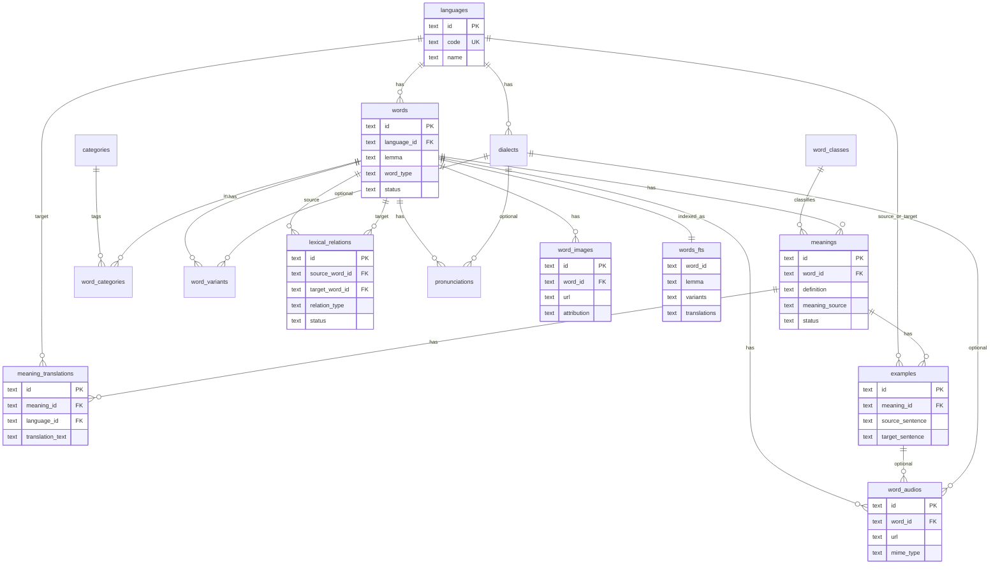

<p align="center">
  
</p>

# SambasKu Database (public dataset)

Repositori **publik** untuk **artifact kamus offline** aplikasi
**SambasKu** (Kamus Digital Sambas-Indonesia).

Ini **bukan** production database, **bukan** backup akun, dan
**bukan** tempat menyimpan token. Hanya salinan sanitasi korpus
`published` + `is_verified` (lemma + makna + contoh + media + relasi) yang boleh
diunduh klien (mobile / kelak web) lewat HTTPS.

## ERD publik (lemma + korpus)



Kontrak lengkap: [`schema/v1.md`](schema/v1.md) · DBML: [`schema/erd.dbml`](schema/erd.dbml)
(tempel ke [dbdiagram.io](https://dbdiagram.io/d) bila mau edit visual).

## Scope

| Masuk dataset | Di luar (pakai API / repo lain) |
| --- | --- |
| Lemma, makna, terjemahan, contoh | Auth, users, vote, komentar |
| Varian, relasi leksikal, pelafalan | Diskusi, notifikasi, audit |
| Gambar & audio publik + FTS | Wisata, usaha, kuliner, acara, pantun |
| Referensi: bahasa, dialek, kelas kata, kategori | Backup full Turso (`sambasku/sqlite`) |

## Apa isi repo ini?

| Ada di git | Tidak di git (Release assets) |
| --- | --- |
| README, LICENSE, logo | `database.sqlite.gz` |
| `schema/` (kontrak DDL + ERD) | `manifest.json` |
| `metadata/active.json` (pointer rilis aktif) | `SHA256SUMS` |
| `scripts/` (export + validate) | |

```text
database/
├── README.md
├── LICENSE
├── logo.png
├── package.json
├── scripts/               # export + validate
├── schema/
│   ├── v1.md              # kontrak schema_version = 1
│   ├── erd.dbml           # ERD publik (dbdiagram.io)
│   └── QUESTIONS.md       # keputusan allowlist
├── metadata/
│   ├── active.example.json
│   └── active.json        # pointer Release aktif
└── (GitHub Release tag vN)
    ├── database.sqlite.gz
    ├── manifest.json
    └── SHA256SUMS
```

## Source of truth

```text
Staging / production DB (privat, libSQL / sqld)
        │  export allowlist (`scripts/` + org secrets / .env lokal)
        ▼
GitHub Release di repo ini (imutabel per vN)
        │  HTTPS
        ▼
SQLite di perangkat (replica lokal)
```

Arah panah **satu arah**. Repo ini tidak pernah mengisi production.

## URL stabil (setelah Release)

Pointer aktif (mudah rollback tanpa menghapus tag lama):

```text
https://raw.githubusercontent.com/sambasku/database/main/metadata/active.json
```

Asset per rilis (contoh v2):

```text
https://github.com/sambasku/database/releases/download/v2/manifest.json
https://github.com/sambasku/database/releases/download/v2/database.sqlite.gz
https://github.com/sambasku/database/releases/download/v2/SHA256SUMS
```

Klien memverifikasi **sha256** di manifest sebelum mengganti DB lokal.
Gagal verify = tetap pakai DB lama.

## Siapa yang menulis ke sini?

| Aktor | Cara |
| --- | --- |
| Pipeline export (**Fase DS**) | `scripts/` di repo ini → buat GitHub Release + update `active.json` |
| Manusia / admin (Fase D) | Console / CLI memicu pipeline yang sama |
| Mobile / web publik | **Hanya unduh** HTTPS - tanpa token DB |

Fine-grained PAT (Contents / Releases write) hanya di **CI monorepo
privat**, bukan di app klien.

## Yang tidak dilakukan di repo ini

- Tidak menyimpan tabel `users`, email, password, session, OTP, token
- Tidak menyimpan kontribusi pending, audit, vote, bookmark, inbox
- Tidak menyimpan domain non-kamus (places / usaha / kuliner / events / pantun)
- Tidak commit file `.sqlite` / `.gz` ke branch `main` (lihat `.gitignore`)
- Tidak menyamakan "Release dataset" dengan "Backup production"
- Tidak menerima koneksi Turso dari HP / browser publik

## Schema & evolusi

- Kontrak: [`schema/v1.md`](schema/v1.md) · ERD: [`schema/erd.dbml`](schema/erd.dbml)
- Keputusan allowlist: [`schema/QUESTIONS.md`](schema/QUESTIONS.md)
- Non-breaking (nullable / default): tetap `schema_version = 1`
  - 2026-10-31: `meanings.meaning_source`, `word_images.attribution`,
    `lexical_relations.status` + `is_verified`
- Breaking: naik `schema_version` + `min_app_version`
- App lama menolak artifact baru lewat cek schema; tetap di DB lama

## Status Fase DS

| Langkah | Status |
| --- | --- |
| Repo publik + README | **Ada** |
| Schema v1 + ERD | **Ada** - `v1.md` + `erd.dbml` |
| Script export | **`scripts/`** - `pnpm dataset:export` |
| Tes validate (forbidden cols) | **Ada** - `pnpm test` |
| Actions Release | **Ada** - `workflow_dispatch` `export-release.yml` |
| Release aktif | Lihat `metadata/active.json` |
| **Fase B** Mobile consume | **Ditunda** sampai DS hijau + konsumsi siap |

### Menjalankan export (maintainer)

Dari folder root repo ini (butuh `DATABASE_URL` libSQL staging/prod):

```bash
cp .env.example .env   # isi DATABASE_URL + DATABASE_AUTH_TOKEN (sqld / Turso)
pnpm install
pnpm dataset:export
# output: tmp/dataset-export/
#   database.sqlite
#   database.sqlite.gz
#   manifest.json
#   SHA256SUMS
```

Env opsional: `DATASET_RELEASE_VERSION`, `DATASET_CHANNEL`, `DATASET_OUT_DIR`,
`DATASET_MIN_APP_VERSION`.

Lokal: `.env` (gitignored). CI: org secrets `DB_*_TURSO_*` (lihat
`docs/github/org-db-secrets.md`). Jangan commit token.

### GitHub Actions (Release)

Workflow: [`.github/workflows/export-release.yml`](.github/workflows/export-release.yml)
(`workflow_dispatch`).

1. Pastikan org secrets sudah diisi (prioritas):
   - `DB_STAGING_TURSO_URL` / `DB_STAGING_TURSO_AUTH_TOKEN`
   - `DB_PRODUCTION_TURSO_URL` / `DB_PRODUCTION_TURSO_AUTH_TOKEN`
   - Acuan: `docs/github/org-db-secrets.md` (monorepo)
   - Fallback lama repo: `DATABASE_URL` / `DATABASE_AUTH_TOKEN`
2. Actions → **Export & Release Dataset** → Run workflow
3. Pilih `channel` (staging/production), opsional `release_version`
4. `dry_run=true` untuk test export tanpa Release/commit
5. Jika step export `fetch failed` / preflight gagal: Cloudflare sering
   blokir IP **GitHub-hosted**. Pilih `runner=self-hosted` (homelab yang
   bisa `SELECT 1` ke sqld), atau export lokal lalu Release manual.

Job akan: preflight TLS → `pnpm test` → export → (skip jika sha sama) →
GitHub Release `vN` + update `metadata/active.json`.

### Export lokal (jika CI tidak reach DB)

```bash
# database/.env → DATABASE_URL=https://db-sambasku-staging.iamutaki.com + token
pnpm dataset:export
# artifact di tmp/dataset-export/ + out/
```

Lalu di GitHub: buat Release tag `vN` + unggah `database.sqlite.gz`,
`manifest.json`, `SHA256SUMS`, dan update `metadata/active.json`.

## Lisensi

Lihat [LICENSE](LICENSE). Isi korpus bahasa (lemma, arti, contoh) mengikuti
kebijakan editorial SambasKu; artifact teknis di repo ini memakai lisensi
repo kecuali dinyatakan lain di Release notes. Kredit foto stock mengikuti
field `word_images.attribution` bila ada.
